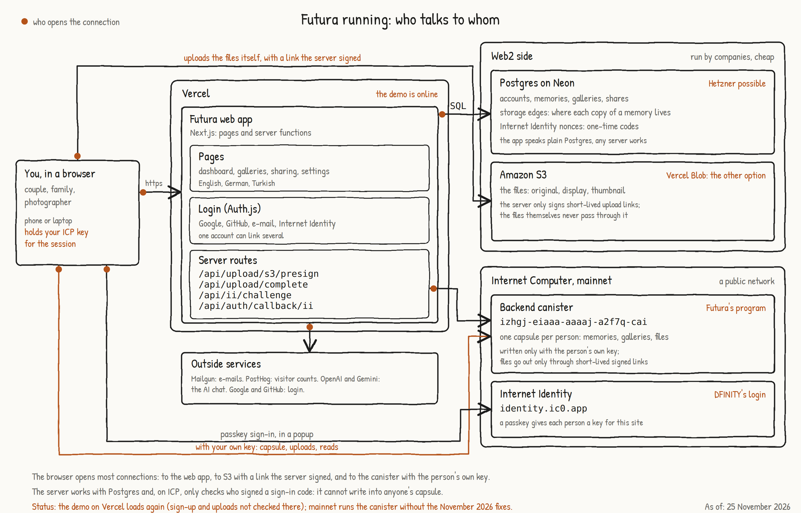

# Futura


Futura keeps the most meaningful memories of a person (photos, videos, notes) and lets them share them, hand them over and keep them for the long term. It works like a normal web service, and people who want "forever" storage can keep their memories on the Internet Computer (ICP) instead, in a capsule they control with their own key.

This repository is the web app. The canisters (the ICP side) live in [futura_alpha_icp](https://github.com/552020/futura_alpha_icp).

## Status (November 2026)

- **Code:** all test suites pass (web unit tests, Internet Identity browser tests, canister tests); CI green.
- **Site:** https://futura-alpha-552020s-projects.vercel.app — the demo loads again (25 November 2026; sign-up and uploads not checked there). The old domain futura.now is no longer ours.
- **ICP mainnet:** backend canister `izhgj-eiaaa-aaaaj-a2f7q-cai` is live; the canister fixes of November 2026 are not deployed there yet.
- **Analysis:** where the project stands, what it could be, and the state of ICP and blockchain: see the [desk](#desk).

## How it is built



Step by step: [signing in with Internet Identity](public/diagrams/signin-ii-steps.png), [uploading to S3](public/diagrams/upload-web2-steps.png), [uploading to ICP](public/diagrams/upload-icp-steps.png), [the local test setup](public/diagrams/local-test-setup-running.png). All drawn by `docs/diagrams/tools/gen.py`; captions on the desk page [Sketches](docs/desk/sketches.md).

- **Web app:** Next.js on Vercel, in English, German and Turkish. Login with Google, GitHub, e-mail and password, or Internet Identity.
- **Web2 side (default):** Postgres for accounts, memory details, galleries and shares; Vercel Blob or Amazon S3 for the files.
- **Web3 side (a choice per person):** a backend canister on ICP holding one capsule per person. The browser writes to it directly with the person's own Internet Identity key; Futura's server only checks sign-in proofs there.

The longer explanation, for technical readers new to the project: [docs/desk/architecture.md](docs/desk/architecture.md). For developers, following the code (tables, canister, sign-in, uploads): [docs/desk/architecture-code.md](docs/desk/architecture-code.md).

## Using Futura

**Web2:** create an account and log in, then go to the **Dashboard** to add or delete files and folders.

**Web3:** create an account and log in, go to **Settings** and choose **Web3**, connect your **Internet Identity** under **ICP**, then use the **Dashboard** as usual. Switching between Web2 and Web3 changes where new memories go; existing ones are not moved.

**Other features:**

- **Gallery sharing:** share image galleries with others.
- **Client selection:** clients pick photos from a gallery and the photographer is notified by e-mail. Needs a photographer-client relation set up in the database.


## Vision

The starting point is **wedding photography**: the photographer delivers the gallery through Futura, the couple owns it, and keeping it "forever" is an option. From there, Futura aims at **digital inheritance**: your descendants inherit your archive, and with **Transcendance** (an AI interviewer today) could one day talk with a reflection of your life. Partner photographer: [Salih Kurbet Films](https://www.instagram.com/salih_kurbet_films/).

ICP is used for what a public network does well: ownership that does not depend on us, rules for who may see what and when, and passkey login. It is not meant to be the only copy of anyone's files: storage there costs far more than cloud storage. The reasoning, with sources: [docs/desk/icp-and-blockchain.md](docs/desk/icp-and-blockchain.md).

## Desk

The desk is the project's working material, rendered at `/desk` for admins (the app's own login, admin role; set `ADMIN_EMAILS` or give a user the `admin` role). Its pages are the files in [docs/desk/](docs/desk/), grouped by their first line `<!-- desk: Group -->`:

- [Futura: where it stands and what it could be](docs/desk/stand.md)
- [How Futura is built](docs/desk/architecture.md)
- [How Futura works in the code](docs/desk/architecture-code.md)
- [Sketches](docs/desk/sketches.md)
- [Personal canisters and inheritance](docs/desk/personal-canisters.md): a canister of one's own that Futura cannot touch, and handing memories to heirs. Built and tested locally, not on mainnet; the web app can create a personal canister
- [ICP and blockchain in November 2026: alive, or eaten by AI?](docs/desk/icp-and-blockchain.md)

## Development

Requirements: Node 24 and pnpm 10 (pinned in `package.json`).

```bash
pnpm install
cp .env.local.example .env.local   # fill in what you need
pnpm dev:nextjs
```

| Command                     | What it does                                                                                           |
| --------------------------- | ------------------------------------------------------------------------------------------------------ |
| `pnpm type-check`           | TypeScript                                                                                             |
| `pnpm lint`                 | ESLint                                                                                                 |
| `pnpm test:run`             | Unit and integration tests (integration tests need the local database below)                           |
| `pnpm build`                | Production build                                                                                       |
| `pnpm exec playwright test` | Browser tests; the Internet Identity ones need a local ICP network, see [e2e/README.md](e2e/README.md) |

### Database

The app talks to Postgres over the standard wire protocol (node-postgres via
Drizzle, `src/db/pg-pool.ts`). The same code works with Neon, a local Docker
Postgres, or a self-hosted server such as Hetzner behind PgBouncer.

| Variable                | Purpose                                                         |
| ----------------------- | --------------------------------------------------------------- |
| `DATABASE_URL`          | Runtime connection (pooled endpoint / PgBouncer)                |
| `DATABASE_URL_UNPOOLED` | Direct connection for scripts and `drizzle-kit`                 |
| `DATABASE_CA_CERT`      | Optional PEM of a private CA; pins TLS for self-hosted Postgres |
| `TEST_DATABASE_URL`     | Integration tests; they only run when it points at localhost    |

Local setup:

```bash
docker compose -f docker-compose.dev.yml up -d   # Postgres on 127.0.0.1:5452
cat .env.test.local.example >> .env.local
pnpm db:push
pnpm test:run   # integration tests run because the DB is local
```

### ICP

The canisters, their interface files and the local ICP network setup are in [futura_alpha_icp](https://github.com/552020/futura_alpha_icp). The app reads the canister IDs and the ICP host from `NEXT_PUBLIC_*` variables at build time; the values for a local network are in [e2e/README.md](e2e/README.md).

## License

MIT, see [LICENSE](LICENSE). The ICP side is MIT too: [futura_alpha_icp](https://github.com/552020/futura_alpha_icp).
